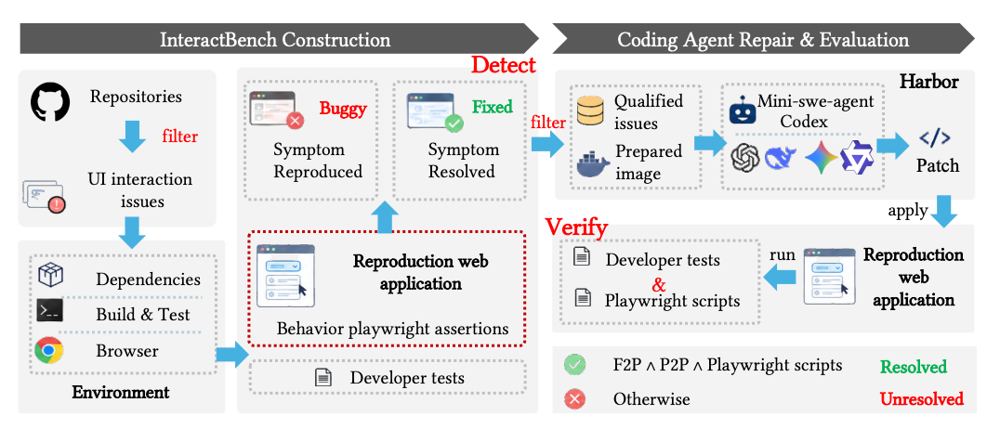
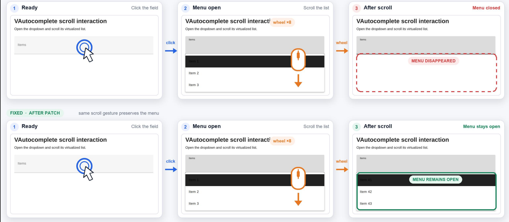

# InteractBench

### A Benchmark and Empirical Study of Coding Agents for Interaction-Driven Web UI Repair

[Overview](#overview) · [Quick Start](#quick-start) · [Evaluation](#evaluation) · [Results](#results) · [Citation](#citation)

InteractBench evaluates whether coding agents repair **how Web interfaces behave**,
not just how they look. It contains **103 interaction-driven defects from 28
open-source projects**, covering actions such as clicking, typing, keyboard
navigation, scrolling, and hovering.

Every task includes an issue description, a fixed base revision, a minimal
reproduction page, Playwright interaction checks, and selected developer tests.
Candidate patches are assessed in an independent verifier environment.

<!-- Paper link: add the public paper URL when available. -->

## Overview

InteractBench pairs historical issues with reproducible browser interactions.
During task construction, checks are validated against the pre-fix and fixed
implementations. During evaluation, an agent receives the issue and base
repository; an independent verifier evaluates its candidate patch using the
same fixed interaction checks and developer tests.



This repository distributes source-build tasks: users build the Agent and
Verifier environments locally from the supplied Dockerfiles. Maintainer-built
task images are not required.

<details>
<summary><strong>Example: a dropdown that closes while scrolling</strong></summary>

In Vuetify issue #22850, scrolling an open autocomplete list unexpectedly closes
the dropdown. A correct repair must allow the list to scroll while keeping the
menu open. An image of an open menu alone cannot establish that scrolling
actually occurred.



</details>

## Quick Start

**Requirements:** Python 3.12, Git, Harbor 0.22.0, and Docker with Compose,
BuildKit, and Linux x86-64 container support. Source repositories, public base
images, package registries, and browser downloads must be reachable during
preparation and image construction.

> **Release status:** this source-build release is a candidate. Static checks
> have passed; all-task image builds and end-to-end execution have not yet been
> validated. See [release.json](release.json).

### 1. Install and check the release

Keep the virtual environment, build inputs, and job outputs outside the release
checkout so that its file-integrity checks remain valid.

```bash
git clone https://github.com/LayTAO/SWE-Bench-Interact-Benchmark.git
cd SWE-Bench-Interact-Benchmark

python3.12 -m venv ../interactbench-venv
source ../interactbench-venv/bin/activate
python -m pip install harbor==0.22.0
python runtime/validate.py
```

### 2. Prepare one task

```bash
python runtime/prepare.py \
  --instance unovue__reka-ui-2749 \
  --output ../interactbench-single
```

Preparation fetches and verifies the exact base commit, exports history-free
source into both build contexts, and materializes evaluation assets only in the
Verifier context. It does not build the images. Existing output directories
are never overwritten.

### 3. Configure and run

Edit `../interactbench-single/job.json`:

- Set `agents[0].name` and `agents[0].model_name` for your chosen agent and model.
- Set `jobs_dir` to `../interactbench-runs` and `job_name` to `interactbench-single`.
- Start with `n_concurrent_trials: 1`; keep `n_attempts: 1` for one attempt per task.

Provide credentials through the agent's supported environment variables; do not
put keys in the repository. If using a different provider, update
`agent.allowed_hosts` in the prepared task's `task.toml` to permit its API hosts.

```bash
harbor run --config ../interactbench-single/job.json
python runtime/summarize.py ../interactbench-runs/interactbench-single
```

Harbor builds the two images locally and runs the task. Subsequent builds can
reuse Docker's build cache. Task-specific resource limits and timeouts are in
`task.toml`; builds also require host memory and disk space.

### Run all 103 tasks

```bash
python runtime/prepare.py --all --output ../interactbench-prepared
```

Configure `../interactbench-prepared/job.json` in the same way, choose a new job
name, and run it with `harbor run --config`. Increase concurrency only after a
single-task run succeeds and host resource usage has been checked.

## Evaluation

The agent works on the base repository in `/workspace/repo`. The runtime captures
its production patch and transfers it to a separate verifier. Evaluation assets
are not mounted into the Agent environment.

The verifier applies the patch to clean base source, performs the required
build, and runs two complementary kinds of checks:

- **Browser interaction checks:** Health checks the intended implementation is
  running; Trigger checks the required interaction occurs; Symptom checks the
  expected behavior during and after that interaction.
- **Developer tests:** all selected fail-to-pass (F2P) and pass-to-pass (P2P)
  tests must pass.

A failed browser check does not by itself skip developer tests when their
prerequisites are satisfied. `reward=1` requires a valid, successfully applied
patch, a successful required build, passing browser interaction checks, and all
selected F2P/P2P tests passing. A failed required check yields `reward=0`.
Agent-authored tests do not replace the fixed evaluation checks.

## Results

The accompanying paper reports the following results on **103 tasks per
configuration**. These describe the paper's experiments, not an end-to-end
validation of the newly published source-build release. Cost is the paper's
reported mean model-call cost per task in USD.

| Agent | Model | Resolved | Resolved (%) | Avg. Cost (USD) |
| --- | --- | --- | --- | --- |
| Codex | GPT-5.6 Sol | 59/103 | 57.28% | $1.33 |
| Codex | DeepSeek V4.1 Flash | 56/103 | 54.37% | $0.05 |
| Codex | GPT-5.5 | 42/103 | 40.78% | $2.26 |
| mini-swe-agent | DeepSeek V4.1 Flash | 59/103 | 57.28% | $0.08 |
| mini-swe-agent | GPT-5.6 Sol | 51/103 | 49.51% | $2.94 |
| mini-swe-agent | Gemini-3.7-Flash-High | 51/103 | 49.51% | $3.81 |
| mini-swe-agent | Gemini-3.1-Flash-Lite | 17/103 | 16.50% | $0.09 |
| mini-swe-agent | Qwen3-30B-A3B-Thinking-2507 | 15/103 | 14.56% | $0.04 |

The study also examines repair failures, environment preparation, and differences
between developer-test, interaction-based, and screenshot-based verification.

## Citation

Paper citation details and the public paper link will be added when available.
Repository citation metadata is provided in [CITATION.cff](CITATION.cff).

<!-- Add the finalized paper BibTeX here; do not copy placeholder authors or DOI. -->
